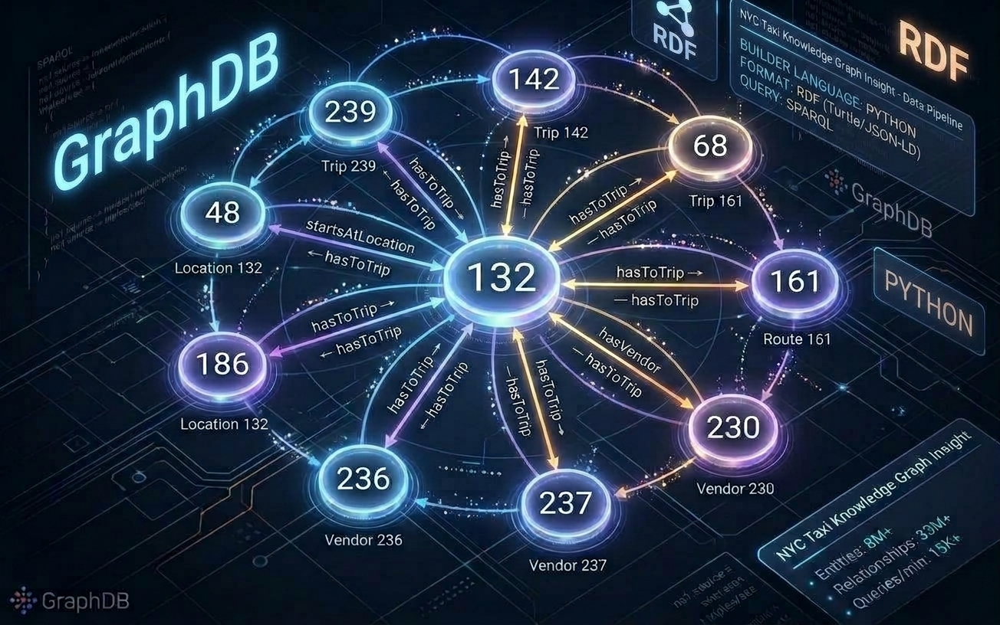

# NY TAXI ANALYSIS WITH KNOWLDGE GRAPH ( RDF & SPARQL)

## 📌 Project preview
This project analyzes the NYC taxi dataset using a knowledge graph and SPARQL. Fleet management often asks complicated business questions about the transportation network, such as which zones connect other zones, or which trip loops exist. In SQL, these multi-hop questions need many repeated self-joins, which become complex to write and slow to run. A knowledge graph models trips as relationships between zones, so these questions can be expressed more naturally.

The project focuses on multi-hop trip and demand network analysis.

## 📑 Business Questions:
`Question 1: Which zones have the highest betweenness centrality?`

**Analytical Target:** Fleet management can identify zones that should never be neglected in the app or service, because many shortest trip routes between other zones pass through them, even if they are not the busiest zones.

`Question 2: Which sets of zones form a closed loop?`
E.g., JFK → A → Manhattan → JFK
* **Analytical Target:** Fleet management can identify circular trip flow patterns between zones, for example demand that leaves the airport and returns to it.

`question3: Extract multi-hop trip paths sharing the same origin location where the trip's `total_amount` exceeds $50

* **Analytical Target:** Demonstrate the power of graph pattern matching for executing complex, multi-hop path analyses and filtering relational attributes seamlessly without heavy SQL `JOIN` operations.
[query3.png](images/query3.png)
*
## 📈 Engineering Decisions

- Based on the business questions, only the pickup and drop-off zone columns were kept. Trips were grouped by (pickup zone, drop-off zone) to count the trips per route. Trips that start and end in the same zone were removed, because they add no structural information to the graph. This left 32,552 edges.
- To associate transaction properties (such as `total_amount`) with the relationship between pickup and drop-off locations, standard RDF constraints require a reification pattern. Since standard direct properties on a triple are limited, we implemented **Blank Nodes (`BNode`)** to act as intermediate trip entities. This allows us to cleanly attach multiple attributes—such as origin, destination, and fare—to a single trip event while maintaining strict W3C RDF compliance.

## 🛠️ System Architecture

- **Data Ingestion & Transformation:** Python with Pandas processes the raw NYC Yellow Taxi parquet files, filtering out self-loops and aggregating edge counts.
- **RDF Knowledge Graph Generation:** Using `rdflib`, trip records are modeled into RDF triples, employing custom namespaces (`ex:`) and blank nodes (`BNode`) for reification to preserve transaction properties like `total_amount`.
- **Database & Query Engine:** GraphDB acts as the local triple store (`taxi-KG` repository) where data is imported in Turtle (`.ttl`) format.
